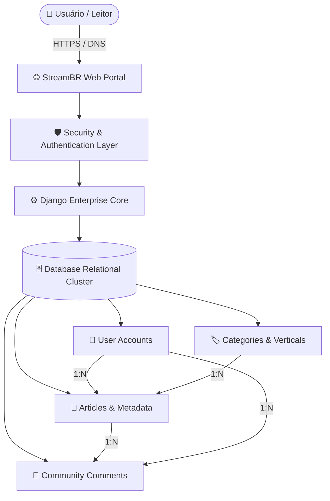

  

    

  # 🎮 StreamBR Media Group
  ### *A maior plataforma independente de jornalismo, cobertura e comunidade sobre streaming e eSports do Brasil.*

  

    
    
    
  

  

    <b>Transformando a cultura digital em notícias de alto impacto. Da Tribo à CazéTV, documentamos o pulso do entretenimento ao vivo.</b>
  

---

## 🌐 Sobre a StreamBR

A **StreamBR** nasceu para suprir a necessidade de um jornalismo especializado, dinâmico e imersivo voltado para o mercado bilionário de criadores de conteúdo e streaming no Brasil.

Combinamos tecnologia de ponta, estética inspirada na cultura gamer/broadcasting e infraestrutura de alta performance para entregar notícias em tempo real, análises de bastidores, narrativas de grandes comunidades e dados de audiência que moldam o mercado nacional.

---

## ⚡ Pilares Editoriais e Coberturas

<table width="100%">
  <tr>
    <td width="33%" align="center">
      <h3>🏆 Tribo & CS</h3>
      
Coberturas exclusivas de Majors, análises táticas e todo o movimento comunitário liderado por Alexandre "Gaules".

    </td>
    <td width="33%" align="center">
      <h3>📺 CazéTV & Broadcast</h3>
      
A revolução das transmissões esportivas digitais encabeçada por Casimiro Miguel e o novo modelo de mídia independente.

    </td>
    <td width="33%" align="center">
      <h3>🚗 GTA RP & Narrativas</h3>
      
Os bastidores dos maiores servidores do mundo (Cidade Alta e Complexo), celebrando estrelas como Coringa e Paulinho o Loko.

    </td>
  </tr>
  <tr>
    <td width="33%" align="center">
      <h3>🎙️ Just Chatting & Cultura</h3>
      
Debates sobre tendências, podcasts, reacts e a longevidade dos ícones de variedade como Alanzoka.

    </td>
    <td width="33%" align="center">
      <h3>🎖️ Prêmios & Mercado</h3>
      
Acompanhamento de eventos corporativos, Prêmio eSports Brasil, investimentos publicitários e profissionalização do setor.

    </td>
    <td width="33%" align="center">
      <h3>💬 Comunidade & Hub</h3>
      
Espaço colaborativo e aberto para creators e fãs interagirem, debaterem e publicarem artigos de opinião.

    </td>
  </tr>
</table>

---

## 🚀 Diferenciais da Plataforma

- **Design Dark Ultra-Imersivo:** UI/UX moderna projetada com inspiração nas interfaces da Twitch e estúdios de eSports, reduzindo o cansaço visual e destacando o conteúdo audiovisual.
- **Ecossistema Colaborativo:** Criadores autenticados têm liberdade para submeter matérias, gerenciar suas próprias publicações e debater tendências com outros membros.
- **Proteção & Moderação Ativa:** Barreiras de engajamento (*Login Walls*) e gestão por níveis de acesso (Admin/Staff/Leitor) para garantir um ambiente livre de toxicidade.
- **Mídia em Alta Definição:** Suporte dinâmico e automatizado para banners panorâmicos e capturas de momentos históricos das streams.

---

## 🏛️ Arquitetura de Software e Infraestrutura

A StreamBR é sustentada por uma infraestrutura robusta, orientada a escalabilidade e fidelidade de dados:

- **Core Framework:** Django 5+ (Arquitetura Model-Template-View)
- **Frontend Engine:** HTML5 Semântico, Bootstrap 5 Modern Grid, Vanilla JS ES6+, Google Fonts (Rajdhani & Inter)
- **Database Engine:** Relational SQLite / PostgreSQL Ready
- **Cloud Infrastructure:** PythonAnywhere Linux Cloud Hosting
- **Security Protocols:** Proteção contra CSRF, XSS, Clickjacking e SQL Injection nativas

---

## 👥 Nossos Canais

- **Portal Oficial:** [victorhenriq.pythonanywhere.com](https://victorhenriq.pythonanywhere.com)
- **Comunidade:** Aberta a todos os entusiastas e criadores de conteúdo do Brasil.

---

  StreamBR Media Group © Todos os direitos reservados. Conectando o Brasil aos maiores momentos da história do streaming.

